<a href="https://beat.rip"><b>Open Beat.rip</b></a> &nbsp;·&nbsp; <a href="./SUPPORT.md"><b>Support</b></a> &nbsp;·&nbsp; <a href="./SECURITY.md"><b>Security</b></a> &nbsp;·&nbsp; <a href="./CHANGELOG.md"><b>Changes</b></a> &nbsp;·&nbsp; <a href="https://github.com/loverhaterlmao/snns-suite"><b>All S&NS projects</b></a>

 

<!-- v2:a -->
<table>
<tr>
<td width="150" align="center"></td>
<td>
<b>Beat.rip for Windows</b>: a small window onto beat.rip with its own icon, its own start screen, and a frame that takes the app's colour.  
  <b>On a phone:</b> open <a href="https://beat.rip">beat.rip</a> in your browser and choose <i>Add to Home Screen</i> (iPhone: the Share button; Android: the menu, then <i>Install app</i>).
</td>
</tr>
</table>
<!-- /v2:a -->

## What it is

Check one name across 57 platforms and every popular domain, asked of each platform itself, with an honest "unknown" when one will not say. Then ask thousands more sites in one go (forums, communities, code hosts, wikis), on the site under **Everywhere** or from your terminal.

**Open it:** [beat.rip](https://beat.rip)

Beat.rip is made by Sick & Nexra Studios (S&NS). Its source code is closed. This repository is where to find it, how
to get help, and where to report problems.

## From a terminal

`beatrip <name>` asks more than 6,800 sites whether a name is taken, from your own computer. Each site is asked once and read against what it is known to say for a name that exists and for one that does not; every "taken" is double-checked against a made-up name on the same site; anything unclear is reported as "could not tell", never as free. No account, no key. It needs Node.js 20 or newer.

    irm https://beat.rip/install.ps1 | iex            # Windows (PowerShell)
    curl -fsSL https://beat.rip/install.sh | sh       # macOS and Linux

    beatrip yourname                 # every site in the list, in about a minute and a half
    beatrip yourname --top 300       # only the most visited, in a few seconds
    beatrip yourname --json          # for scripts; --csv file.csv for a spreadsheet

Both install scripts are short and plain, and each checks what it downloads against a SHA-256 it carries. The list of sites began as the [Maigret](https://github.com/soxoj/maigret) project's open database (MIT licence); every site in ours was measured and answered correctly before it was let in.

## On the site

The **Everywhere** section of [beat.rip](https://beat.rip) does the same check from the page: type a name and watch the answers arrive, site by site, with a spreadsheet of all of them at the end. There is an address for programs too: `GET https://beat.rip/api/wide?name=yourname` streams one line per site.

<!-- v2:b -->
## The desktop app

- **Getting it:** [the latest release](https://github.com/loverhaterlmao/beat-rip/releases/latest). Unzip it and open `Beat.rip.exe`. There is nothing to install.
- **What it is:** a window onto [beat.rip](https://beat.rip). Your work stays in your account on the site; the app keeps only your sign-in, in a folder beside itself.
- **What it needs:** Windows 10 or 11. It uses the WebView2 runtime, which Windows 11 has built in.
- **The warning Windows shows:** "unknown publisher", the first time. The app is not code-signed yet. Check the file's
  SHA-256 against the one in the release notes if you want to be sure it is ours.

## The small print

[Terms of use](TERMS.md) · [Privacy](PRIVACY.md) · [Acceptable use](ACCEPTABLE_USE.md) · [Licence](LICENSE)
<!-- /v2:b -->

## In this repository

| File | |
|---|---|
| [SUPPORT.md](SUPPORT.md) | Reaching a person |
| [SECURITY.md](SECURITY.md) | Reporting a weakness |
| [CONTRIBUTING.md](CONTRIBUTING.md) | How to help when the source is closed |
| [CODE_OF_CONDUCT.md](CODE_OF_CONDUCT.md) | How we treat each other here |
| [CHANGELOG.md](CHANGELOG.md) | What changed, and when |
| [LICENSE](LICENSE) | What you may and may not do |

Terms of use, acceptable use and privacy for every S&NS project: [LEGAL.md](https://github.com/loverhaterlmao/snns-suite/blob/main/LEGAL.md).

## Issues

Use this repository's issues for things that are broken or missing in Beat.rip. Say what you did, what you expected
and what happened. Never put passwords, keys or personal details in an issue. Security weaknesses do not go here.

 

Part of the S&NS family 
<a href="https://github.com/loverhaterlmao/noetic-suite"><b>Noetic Suite</b></a> &nbsp;·&nbsp; <a href="https://github.com/loverhaterlmao/claw"><b>Claw</b></a> &nbsp;·&nbsp; <a href="https://github.com/loverhaterlmao/sykbot"><b>Sykbot</b></a> &nbsp;·&nbsp; <a href="https://github.com/loverhaterlmao/beat-rip"><b>Beat.rip</b></a> &nbsp;·&nbsp; <a href="https://github.com/loverhaterlmao/ink"><b>Ink</b></a>  
<a href="https://snns.dev"><b>snns.dev</b></a> &nbsp;·&nbsp; <a href="https://github.com/loverhaterlmao/snns-suite">S&NS Suite</a> &nbsp;·&nbsp; <a href="mailto:support@snns.dev">support@snns.dev</a>

© Sick & Nexra Studios. All rights reserved. No licence to the software is granted by this repository.

